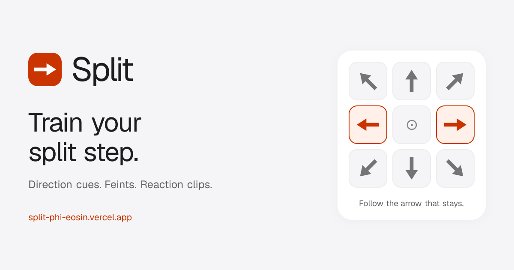

<p align="center">
  <a href="https://split-phi-eosin.vercel.app/">
    
  </a>
</p>

<p align="center">
  <strong>A simple badminton reaction trainer for your laptop.</strong><br />
  Read the cue. Make your move. Return to centre.
</p>

<p align="center">
  <a href="https://split-phi-eosin.vercel.app/"><strong>Open Split ↗</strong></a>
  · <a href="#use-it-on-court">How to use it</a>
  · <a href="#run-locally">Run locally</a>
  · <a href="https://github.com/darkprince558/split/issues">Report an issue</a>
</p>

## What Split does

Split shows unpredictable direction cues for badminton footwork practice. Brief fake arrows can appear before the real cue. Follow the arrow that stays, move in that direction, and return to the centre before the next cue.

The drill runs by itself, so you can practise on court without touching the laptop between cues.

| Feature | What it gives you |
| --- | --- |
| Eight court directions | Choose movements in a court-shaped grid and save named direction presets for next time. |
| Difficulty and timing | Use Warm-up, Club, or Match, choose any level from 1–10, or adjust the timing sliders. Undo restores custom timing after a difficulty change. |
| Feints | Add up to three fake cues. Their frequency and flash time are adjustable. |
| Flexible sessions | Practise for a set number of cues, a time limit, or until you choose to stop. |
| Reaction recordings | Check your camera before starting, save individual clips automatically, and replay your movement with the real cue timestamp. |
| Clip exports | Download one clip or a ZIP containing the session's clips and a CSV cue list with available cue timestamps. |
| Optional seated testing | Enable keyboard or tap answers to measure reaction times. Leave this off for court movement. |
| Accessible controls | System fonts, keyboard focus, readable colour checks, responsive layouts, and support for reduced motion and transparency. |

## Use it on court

1. Open **[Split](https://split-phi-eosin.vercel.app/)** and place the laptop where you can clearly see it from the court.
2. Choose your difficulty, session length, and directions. Use **Customize drill** for timing, feints, colours, and sound.
3. Choose whether to **Record reactions**. When enabled, allow camera access when starting; you can also continue without recording.
4. Press **Start drill**. With recording enabled, check that your whole body and movement area are visible in the live preview. Choose a camera if multiple cameras are available, then press **Start 5-second countdown**. Nothing records during the preview.
5. Ignore brief feints, move on the arrow that stays, and return to the centre between cues.
6. Afterward, review your recordings, repeat the drill, or change the setup.

### Keyboard controls

| Key | Action |
| --- | --- |
| `Space` | Pause or resume |
| `Esc` | End the drill |
| Arrow keys or `W A S D` | Cardinal-direction answers when seated testing is enabled |
| `Q E Z C` | Diagonal answers when seated testing is enabled |

## Direction presets and clips

Under **Customize drill → Directions**, select a pattern and choose **Save these directions**. Name it to reuse it later. Presets stay in this browser; Manage lets you remove a preset, with Undo available afterward. Applying a direction preset leaves pace, timing and other settings alone.

**Clip length** offers Standard (about 1.2 seconds after the real cue) or Longer (about 3 seconds). Clipping stays automatic and never delays the cue engine. Pauses are excluded. Ending a drill explicitly stops recording immediately. Review shows cue onset and exports that timing in the session CSV; older clips remain playable without timing metadata.

## iPhone and external cameras

On a compatible Mac/iPhone pair, use [Apple Continuity Camera](https://support.apple.com/en-us/102546). Both devices need the same Apple Account, Wi-Fi and Bluetooth; keep the iPhone locked and mounted with its rear cameras toward the court, or connect it by USB. Open Split on the Mac, allow camera access, and select the iPhone in the preview's camera menu. Refresh cameras under the setup help if needed. The browser must expose the device to Split; some browsers require choosing or allowing it in their own camera settings.

The iPhone supplies the video while the Mac displays cues and stores clips. This does not save into iPhone Photos or pair two browser sessions over the internet. USB webcams and cameras with webcam mode or capture adapters use the same picker. No computer-vision or ML analysis is implemented yet; recorded video and cue timestamps remain available for future analysis.

Interface motion uses short CSS transitions with reduced-motion fallbacks. Cue arrows and slider positions do not animate or wait for transitions.

## Your recordings stay on your device

Split records **video only**, with no microphone audio. Clips are stored in the browser's IndexedDB; settings are stored in localStorage. Split does not upload recordings, and you do not need an account.

New clips include the real cue's onset time and a short reaction tail. Pausing excludes that time from the clip and cue timeline; ending the drill stops recording. Older clips remain playable even when cue timing is unavailable.

**Download clips you want to keep.** Clearing browser data can remove your settings and recordings, and recordings are not shared automatically between browsers or devices.

## Run locally

Use **Node.js 24** and npm.

```bash
git clone https://github.com/darkprince558/split.git
cd split
npm ci
npm run dev
```

Open **[http://localhost:3000](http://localhost:3000)**. Camera access requires HTTPS or localhost. No API keys, database service, or environment variables are needed for the current app.

### Verify a change

```bash
npm test
npm run lint
npm run build
```

To run the production build locally:

```bash
npm run start
```

## Built with

- **Next.js 16, React 19, and TypeScript** for the app.
- **Tailwind CSS and Base UI** for the controls.
- **MediaRecorder and IndexedDB** for browser-local video capture and review.
- **Vercel** for hosting and automatic production deployments.

The cue engine is in [`src/hooks/use-drill-session.ts`](src/hooks/use-drill-session.ts), drill rules are in [`src/lib/drill.ts`](src/lib/drill.ts), and camera capture is in [`src/lib/camera.ts`](src/lib/camera.ts). The setup, drill, summary, and review screens live in [`src/components`](src/components).

## Deployment

GitHub's **`main`** branch deploys automatically to **[split-phi-eosin.vercel.app](https://split-phi-eosin.vercel.app/)** through the Vercel project `split-arrow`.

For the owner's fresh checkout, authenticate GitHub CLI as `darkprince558` and run `npm run setup:git` before committing. That command verifies the account and configures the local commit author. Contributors should keep their own identities.

After pushing, confirm that the exact commit reaches **READY** in Vercel and check the public site. Site metadata and the canonical URL are defined in [`src/lib/site.ts`](src/lib/site.ts); the share image, app icons, manifest, robots file, and sitemap live under [`src/app`](src/app).

## Future direction

Movement analysis with computer vision is a future direction; Split currently provides cues and recordings, not automatic footwork scoring or coaching.

Have an idea or found a problem? [Open an issue](https://github.com/darkprince558/split/issues) with what happened, your browser, and steps to reproduce it.
